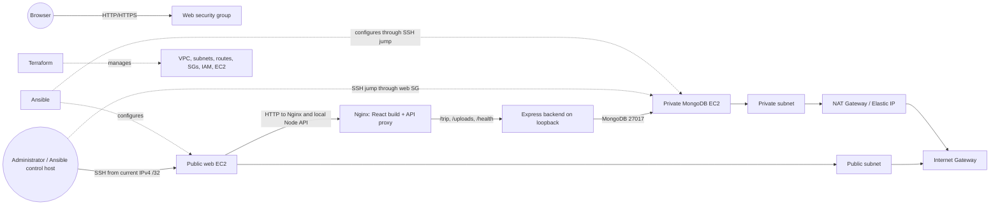

# TravelMemory deployment report

## Objective

Deploy the provided MERN TravelMemory application on AWS with Terraform-managed infrastructure and Ansible-managed configuration. The assignment asks for a VPC with a public and private subnet, Internet and NAT gateways, web and database EC2 instances, SSH restricted to the administrator, security groups and IAM, Ansible software/application deployment, MongoDB security and users, application connectivity, hardening, a detailed report, screenshots/video, and a GitHub submission.

## Architecture

## Component interaction

The browser loads the React single-page application from Nginx on the web EC2 instance. A same-origin React API base URL is required so the built frontend does not call the end user's `localhost:3001`. Nginx proxies `/trip`, `/uploads/`, and `/health` to Express on port 3001; the port is not allowed by the AWS security group or UFW. Express connects to MongoDB over the private subnet on port 27017. Uploaded images are stored in a persistent writable backend directory and served by Express under `/uploads/`.

Terraform defines the VPC (`10.0.0.0/16`), public (`10.0.1.0/24`) and private (`10.0.2.0/24`) subnets, IGW, NAT Gateway/EIP, route tables, two Ubuntu EC2 instances, encrypted gp3 roots, IMDSv2, an EC2 role/profile with SSM core, and security groups. The web SSH rule uses a single administrator `/32`; MongoDB and database SSH are allowed from the web security group. The private database instance has no public IP.

## Current implementation and verification

Terraform configuration exists and historic screenshots show initialization/validation and a prior plan. The plan is stale; the current CLI could not be found in the resumed session and the AWS CLI returned `NoCredentials`. Current AWS resources, current public IPv4, the EC2 key file, and live network/security settings therefore remain unverified. No Ansible deployment or application health/browser/MongoDB/security-hardening test has been run.

The Terraform configuration was reviewed locally. It selects Ubuntu 22.04 x86_64 and `t3.micro`, encrypts 12 GB gp3 root volumes, requires IMDSv2, and allows web SSH from `admin_ip/32`. The subnets were hard-coded to `ap-south-1a`; they now use a variable with that default. A current example variables file was added. Database SSH ingress from the web security group was added so Ansible can administer the private host over a ProxyJump; no public SSH ingress was added to the database group.

An Ansible scaffold is now present: separate common, database, and web playbooks; generated inventory from Terraform outputs; MongoDB 8.0 repository/configuration and authenticated user reconciliation; Node.js 22, backend systemd, Nginx, same-origin React build, uploads, UFW, and SSH hardening. Node's `js-yaml` parsed all 12 YAML files, but the playbooks have not had an Ansible syntax check or execution because Ansible is unavailable in the current environment. The Express port is omitted from both public security-group ingress and the UFW allow list; Nginx proxies to it over loopback. The local React test suite passed two tests, and its production build passed using `REACT_APP_BACKEND_URL=/`; executable JavaScript chunks contain no localhost API URL. No deployed integration test has run. The selected application source revision is pinned to `dea21e3390cf6b957d4549de87c0e6ad4bdd7539`.

## Security controls

- Restrict the web SSH source to the actual current administrator IPv4 `/32` and apply only after reviewing the new plan.
- Keep the database subnet private; allow MongoDB only from the web security group and enable database authentication.
- Keep private keys, Terraform state/plans, runtime `.env`, Ansible Vault passwords, and real secrets out of Git.
- Enforce IMDSv2 and encrypted root volumes; use least privilege for application credentials.
- Enable host-key checking, permit SSH only from trusted sources, allow SSH before enabling UFW, then disable root SSH and password authentication after key-based access works.
- The captured screenshot `Screenshot 2026-10-27 105312.png` displays an SSH private key. It is intentionally not copied into evidence and that key should be replaced before any use.

## Cost considerations

The NAT Gateway/EIP has ongoing hourly and data-processing charges. Two EC2 instances, EBS volumes, public IPv4, snapshots, and data transfer can also incur charges. `t3.micro` may be constrained during a Create React App production build; validate memory use before relying on it. Stop/remove resources only after verifying the intended Terraform state and obtaining approval. The assignment's NAT requirement makes a NAT Gateway part of the submitted architecture even when the private host has no persistent need for outbound updates.

## Deployment and cleanup procedure

1. Restore a supported Terraform executable and authenticated AWS CLI session; verify account, `ap-south-1`, current public IPv4, and a replacement key pair because a screenshot exposed the former private key.
2. Copy `terraform.tfvars.example` to `terraform.tfvars`; set the current `/32` source and confirmed key-pair name.
3. Run `terraform fmt -check`, `init`, `validate`, and a fresh `plan -out=tfplan`; inspect every action and cost-bearing resource. Obtain explicit approval before applying. MongoDB playbook uses MongoDB's official Jammy package repository; the runtime installation procedure follows [MongoDB's Ubuntu installation documentation](https://www.mongodb.com/docs/v8.0/tutorial/install-mongodb-on-ubuntu/). Node.js 22 uses the [NodeSource Debian/Ubuntu distribution repository](https://github.com/nodesource/distributions).
4. After approval, apply the reviewed plan; export outputs and verify AWS resources/security groups.
5. Generate Ansible inventory from Terraform outputs, configure encrypted Vault values, run syntax checks and playbooks, then verify services and frontend/backend/database integration.
6. Capture genuine screenshots and update the checklist with exact outcomes.
7. For cleanup, review `terraform plan -destroy` and its impact, then obtain explicit approval before any destroy. Destroying the state-managed stack removes EC2, NAT/EIP, VPC resources, and persistent volumes/data.

## Limitations and pending evidence

This report records the current repository state, not a completed deployment. The current AWS identity and live account resources could not be confirmed, the local Terraform command is unavailable, WSL currently reports no installed Linux distribution, and access to the expected private key path was denied. No GitHub repository has been created or pushed. See `ASSIGNMENT-CHECKLIST.md` for the remaining evidence and submission requirements.
